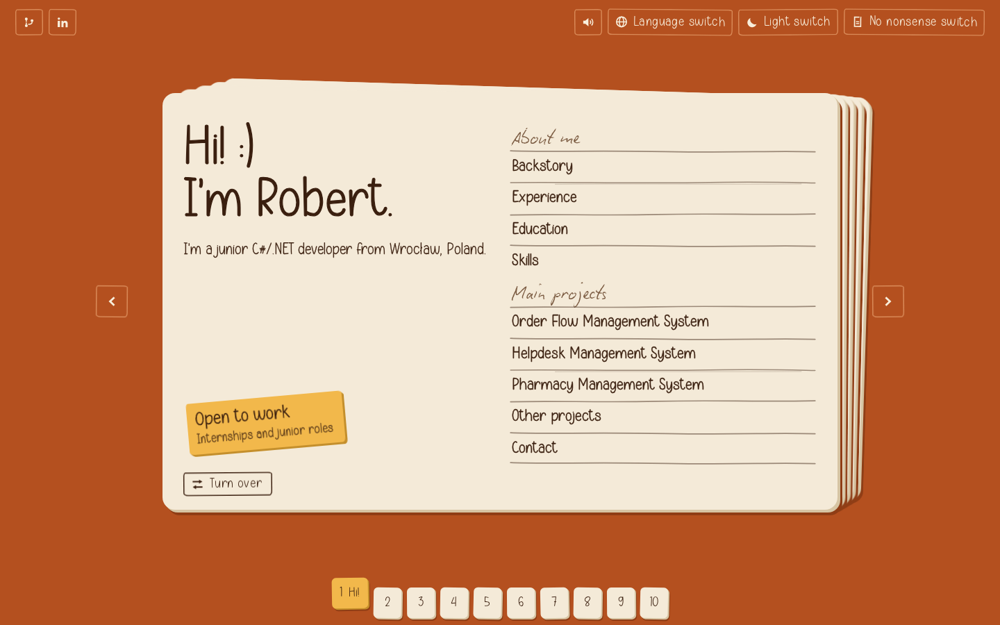

# Bilingual Portfolio Website

A portfolio laid out as a deck of printed show cards on a table. Each section is a card: flip it to read the handwritten note on the back, and the cards you have already played pile up on the left. Polish and English, four light and dark colour variants, and a plain-text version for anyone who just wants the facts.

[Live, Polish](https://portfoliotworekrobert.vercel.app/pl) | [Live, English](https://portfoliotworekrobert.vercel.app/en)



## About

This is the portfolio of Robert Tworek, a Technical Computer Science student at Wroclaw University of Science and Technology and a junior C#/.NET developer looking for a first commercial role. The site has three main projects (OrderFlow, Helpdesk, Pharmacy), an "Other projects" card that fills itself from GitHub, experience, education, skills and a contact card.

## What is in the deck

| Card | What it holds |
| --- | --- |
| Hi! | Introduction, the "Open to work" sticker and a grouped contents list. |
| Backstory | How music led to code, with a small drum sequencer to play with. |
| Experience, Education, Skills | Short notes written in the first person, details on the back. |
| Order Flow, Helpdesk, Pharmacy | One card each: what it is, three facts, the stack. Back: why I built it, what is inside, the hardest part, screenshots. |
| Other projects | Curated extra projects plus any new public repositories from GitHub. |
| Contact | A small form that opens a prepared email, copy-email, and links. |

## Details worth knowing

- **Flip cards.** Every card with more to say has a back, written as a short note.
- **Light switch.** Flips between light and dark. Each flip moves to the next variant: orange and beige, pink and beige, yellow and brown for light; espresso, wine and umber for dark. The choice is remembered.
- **Live GitHub list.** On load, every five minutes and when the tab regains focus, the page reads public repositories of `roposropos` from the GitHub API and adds new non-fork repositories to the "Other projects" card. The last result is cached in `localStorage`, so the card still works when the API limit is reached.
- **Sequencer.** Scheduled on the Web Audio clock, so the beat stays steady. The playhead follows what you hear, clicking a square plays that drum, and the beat stops when you flip or leave the card.
- **Paper sounds.** Card slides, flips and the light switch click are synthesised in the browser, with a toggle in the top bar. Nothing is downloaded.
- **No nonsense switch.** A plain-text version of the whole site, built from the same data as the cards, in the current language.
- **Screenshots** are shown in the colours of the current theme and in true colour on hover.
- **Accessibility.** Keyboard navigation (arrow keys, `F` to flip), visible focus, reduced-motion support, and the plain-text view.

## Project structure

```text
bilingual-portfolio-website-main/
|-- app/               # minimal Next.js shell: robots, sitemap, icon, fallback page
|-- public/
|   |-- site.html      # the whole portfolio, one self-contained file
|   |-- og-image.png   # social preview
|   `-- Robert-Tworek-CV-*.pdf
|-- source/            # editable source that builds public/site.html
|   |-- card.js        # all logic and copy (EN and PL)
|   |-- card.css       # layout, themes, pen dividers
|   |-- build.py       # inlines fonts, icons and screenshots into one file
|   |-- data_raw.js    # project text and screenshots (base64)
|   |-- fonts.json     # subsetted fonts (base64)
|   `-- font-tools/    # script that adds the Polish letters to the two handwriting fonts
|-- docs/screenshots/
|-- next.config.ts     # rewrites /, /pl and /en to /site.html
`-- package.json
```

## Quick start

```bash
pnpm install   # or npm install
pnpm dev
```

Open `http://localhost:3000/pl` or `http://localhost:3000/en`. The page also works on its own: open `public/site.html` in a browser.

### Editing the site

Change text or styles in `source/card.js` and `source/card.css`, then rebuild the single file:

```bash
python3 source/build.py
```

This needs Python 3 and no extra packages. The output goes to `public/site.html`.

### Deployment

The project deploys to Vercel as a normal Next.js app. Set `NEXT_PUBLIC_SITE_URL` if the domain changes (used for the sitemap and robots.txt). The social preview image is a static file, so also update the `og:image` address in `source/build.py` when the domain changes.

## Tech

| Part | Choice |
| --- | --- |
| Site | Plain HTML, CSS and JavaScript in one file, no framework at runtime. |
| Hosting shell | Next.js 16 (rewrites, robots, sitemap) on Vercel. |
| Audio | Web Audio API, all sounds generated in the browser. |
| Data | GitHub REST API (unauthenticated) with a local cache. |
| Build | A short Python script that inlines everything. |

## Look and feel

| Element | Choice |
| --- | --- |
| Type | Simple Handmade for the interface, Biro Script for the handwritten notes. Both are missing Polish letters, so ą ę ć ń ś ź ż ł ó and capitals were drawn in (`source/font-tools/mk.py`). |
| Dividers | Pen strokes drawn as SVG masks, a few variants, slightly wavy. |
| Colour | Flat colours only, a hard offset shadow under every card, no gradients or glow. |
| Details | Taped screenshots, slightly tilted tabs and buttons. |

## Font licences

The two handwriting fonts are third-party. Simple Handmade is a demo version marked "personal use only", and the Biro Script licence does not allow redistributing converted fonts. They are embedded in the page, so check the licences before keeping the site public, or replace them with fonts under an open licence (for example from Google Fonts) by changing `source/fonts.json` and the two `@font-face` rules at the top of `source/card.css`.

## Author

Robert Tworek, Technical Computer Science student at Wroclaw University of Science and Technology.

[GitHub](https://github.com/roposropos) | [LinkedIn](https://linkedin.com/in/tworekrobert)
